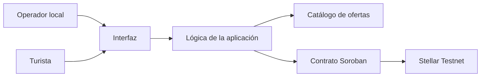

# Product Blueprint

**Nombre del proyecto:** Turistellar

**Repositorio (enlace obligatorio):** [turistellar](https://github.com/Isaac2399/turistellar)

> Los campos marcados como *enlace obligatorio* deben ir como enlace en Markdown, con este formato: `[texto del enlace](https://...)`. Reemplacen el texto y la dirección de ejemplo.

---

## Contenido

1. Priorización de historias
2. Propuesta de valor
3. Flujo de usuario
4. Alcance del MVP
5. Lean Canvas
6. Backlog priorizado (Kanban)
7. Arquitectura inicial
8. Uso de Stellar y justificación

---

## 1. Priorización de historias

> Historias elegidas entre las que propuso el equipo y criterio con que se priorizaron. Son las que pasan al backlog. Extensión: breve.

Trabajo solo. Todas las historias salen de [Isaac2399.md](Isaac2399.md).

**Criterio de priorización:** Entra al backlog lo que hace falta para probar la hipótesis del Problem Brief. Primero, que el turista y el operador miren el mismo historial y que después nadie lo reescriba. En el mismo grupo, que la oferta de la Zona Sur se pueda publicar y encontrar. Al final, el mismo registro visto desde el guía y desde el comedor. El anticipo no entra: en esta zona muchas reservas ni empiezan.

| Prioridad | Historia | Propuesta por | Por qué entra al backlog |
| :---: | --- | :---: | --- |
| 1 | Como turista quiero leer, en la ficha de una familia o un guía, los servicios que ya prestaron y que después no se pueden cambiar, para decidir si les reservo sin fiarme solo del hotel que sale primero. | Isaac2399 | Es la credibilidad que el Problem Brief priorizó. Sin esta lectura, la reserva sigue en el hotel conocido. |
| 2 | Como turista quiero confirmar yo mismo que el servicio ocurrió, para que el historial no lo escriba solo quien lo vende. | Isaac2399 | Sin la confirmación del visitante, la ficha la llena una sola parte y no reemplaza la duda. |
| 3 | Como operador local quiero que cada servicio confirmado quede anotado a mi nombre, para enseñar lo que ya hice sin dejarle la reseña a quien vendió el paquete. | Isaac2399 | Si el historial queda a nombre del intermediario, la confianza sigue concentrada donde está hoy. |
| 4 | Como turista quiero ver juntas las fincas, los guías y los comedores de la Zona Sur, para enterarme de la oferta que no me sale cuando busco el viaje. | Isaac2399 | La otra mitad del problema es que la oferta no se ve. Un historial sin listado no acerca al visitante. |
| 5 | Como familia quiero publicar lo que ofrezco, con el lugar y el tipo de servicio, para que el visitante me encuentre sin depender de un estado de WhatsApp. | Isaac2399 | Es la carga que llena el listado. Sin ella, el turista sigue esperando un mensaje que puede no llegar. |
| 6 | Como guía quiero mostrar los recorridos que ya hice, con la confirmación de quien fue conmigo, para que me contraten a mí y no solo al operador que armó el paquete. | Isaac2399 | Mismo registro, visto desde el guía. Entra porque en Osa la reserva del recorrido se la queda quien arma el paquete. |
| 7 | Como encargado de un comedor quiero que la visita de un grupo quede registrada igual que un tour, para que la próxima vez no me vean solo como una parada camino al parque. | Isaac2399 | Extiende el historial a la comida. El pueblo deja de ser solo una parada si esa visita también queda anotada. |

---

## 2. Propuesta de valor

> Qué resultado obtiene el usuario y por qué elegiría esta solución. En qué se diferencia de cómo resuelve hoy. Conecta con el usuario del Problem Brief. Extensión: 150–300 palabras en total.

**Usuario (del Problem Brief):** Quien usa Turistellar, del lado de la zona, es la persona que ofrece turismo desde su casa o su comunidad. Puede ser una familia con cuartos en Pérez Zeledón, un guía en la península de Osa o un comedor en Golfito. Del otro lado está el turista, tico o extranjero, que arma el viaje en el celular y hoy se queda con el hotel o el tour que ya tiene nombre.

**Resultado que obtiene:** La familia puede enseñar los servicios que ya prestó, con la confirmación de quien los recibió, sin pedirle esa prueba al hotel que vendió el paquete. El turista encuentra esa oferta junto con la del resto de la Zona Sur y, antes de escribir, ve si esa persona ya cumplió con otros visitantes.

**Por qué elegiría esta solución:** Hoy la confianza la pone quien aparece primero. Un estado de WhatsApp no le dice al turista si el guía ya llevó grupos, y en una plataforma la reseña se queda en la ficha de quien cobró. Aquí las dos partes miran el mismo historial. La familia recupera una forma de mostrar su trabajo. El turista elige con esa prueba.

**En qué se diferencia de cómo lo resuelve hoy:** El Facebook de la cámara, el operador y la plataforma pueden corregir una ficha o atribuir el servicio a quien vendió. En Turistellar el visitante, la familia y el resto de la zona consultan el mismo registro, y después ninguno lo reescribe. La lista sirve para que se encuentren. El registro sirve para que la credibilidad deje de quedar en un solo intermediario.

---

## 3. Flujo de usuario

> Recorrido de la persona por la solución de principio a fin, roles y puntos de interacción. Diagrama o secuencia numerada. Extensión: 150–300 palabras.

El recorrido empieza cuando el operador publica y termina cuando otro turista lee lo que quedó anotado. Hay dos roles que actúan, y un tercero que solo mira. El operador local carga la oferta y, el día de la visita, marca que prestó el servicio. El turista busca, lee el historial, reserva y después confirma que ocurrió. El siguiente turista abre la misma ficha. Publicar, buscar y reservar pasan en la aplicación: el lugar, el precio y la foto cambian, y eso no es la prueba. La red entra al firmar la confirmación y al leer el historial.

| Paso | Rol | Qué hace | Punto de interacción |
| :---: | :---: | --- | --- |
| 1 | Operador local | Publica el lugar y el tipo de servicio: cama, guía o comida. | Pantalla de publicación. |
| 2 | Turista | Recorre las fichas de la Zona Sur y abre una. | Pantalla de explorar. |
| 3 | Turista | Lee qué se ofreció, quién lo dio y si un visitante anterior lo confirmó. | Lectura del contrato en Stellar. |
| 4 | Turista | Reserva con esa familia, asociada a su ficha. | Pantalla de reserva. |
| 5 | Operador local | El día del servicio marca que lo prestó y firma con su cuenta. | Billetera y contrato. |
| 6 | Turista | Confirma que ocurrió y firma con su cuenta. Desde ahí la línea no se edita. | Billetera y contrato. |
| 7 | Siguiente turista | Abre la misma ficha y ve la línea nueva. Vuelve al paso 3. | Lectura del contrato en Stellar. |

---

## 4. Alcance del MVP

> Funcionalidad central separada de la deseable que queda fuera. Justificación de por qué el recorte sigue entregando valor. Extensión: 150–300 palabras en total.

| Dentro del MVP (funcionalidad central) | Fuera del MVP (deseable, para después) |
| --- | --- |
| Publicar una oferta de cama, guía o comida, con lugar, en la Zona Sur. | Anticipo, escrow y reembolso. |
| Un listado donde el visitante ve juntas esas ofertas y abre la ficha. | Rampa de colones o dólares hacia la red. |
| Confirmación del servicio por el operador y por el turista. | Declaratoria turística del ICT y permiso de guía. |
| Historial en el contrato, visible en la ficha, sin función para corregirlo o borrarlo. | Comisión, paquetes de mayorista y reseñas de estrellas que se puedan editar. |
| La reserva queda asociada a esa ficha y a nombre del operador. | Pagar por aparecer primero en el listado. |

**Por qué el recorte sigue entregando valor:** La hipótesis se prueba cuando el visitante encuentra a la familia y lee un historial que las dos partes armaron y que después nadie reescribe. Con eso la reserva puede irse con la gente de la zona, que es el resultado del Problem Brief. El anticipo cuida un trato que en Osa, Golfito o Pérez Zeledón muchas veces no llega a existir. Cobrar primero resolvería el paso de después. El recorte también deja fuera el permiso del ICT y el camino hasta Drake o San Vito, porque un registro no consigue ni el permiso ni el viaje. Lo que sí se entrega es lo que mueve la hipótesis: que se sepa quién es y qué ha cumplido, en un historial común.

---

## 5. Lean Canvas

> Lienzo de una página con el modelo del producto. Extensión: enlace (obligatorio).

**Enlace al Lean Canvas (obligatorio):** [Lean Canvas de Turistellar](https://github.com/Isaac2399/turistellar/blob/main/docs/semana2/LeanCanvas.md)

El lienzo cubre el problema, los dos segmentos, la propuesta de valor única, la solución, los canales, las métricas, la ventaja diferencial y la estructura de costos e ingresos. El archivo vive en este mismo repositorio, en `docs/semana2/LeanCanvas.md`.

---

## 6. Backlog priorizado (Kanban)

> Enlace al tablero en GitHub Projects, construido con las historias priorizadas, en columnas y con criterios de aceptación por tarjeta. Extensión: enlace al tablero (obligatorio).

**Enlace al tablero (obligatorio):** [Tablero Kanban en GitHub Projects](https://github.com/users/Isaac2399/projects/1)

El tablero usa las columnas Backlog, Ready, In Progress, In Review y Done. Las siete historias de la sección 1 están en Backlog, de la prioridad 1 a la 7. Cada tarjeta lleva sus criterios de aceptación. Ready, In Progress, In Review y Done quedan vacías: este entregable prioriza el trabajo, todavía no lo está construyendo.

---

## 7. Arquitectura inicial

> Cómo se conectan las partes (interfaz, lógica, Stellar) y en qué punto entra la red. Diagrama simple en imagen. Extensión: 150–300 palabras en total.

**Diagrama:**

La aplicación tiene tres capas. La interfaz es la que usan el turista y el operador. La lógica junta la oferta, que vive fuera de la red, con el historial, que vive en Stellar. El catálogo guarda lugar, precio y foto porque eso cambia y cambiarlo no falsifica un servicio ya dado. La red entra cuando alguien firma una confirmación y cuando alguien lee el historial.

| Capa | Componente | Qué hace |
| :---: | --- | --- |
| Interfaz | Pantallas de explorar, ficha, publicación y reserva | El turista recorre la zona y abre una ficha. El operador carga su oferta y ve lo que ya le confirmaron. |
| Lógica | Aplicación Next.js | Guarda el catálogo, arma la ficha y pide la firma a la billetera. No decide ella sola si un servicio quedó cumplido. |
| Stellar | Cuentas y contrato Soroban en testnet | La cuenta identifica a cada parte. El contrato guarda el servicio confirmado y no ofrece una función para reescribirlo. |

**En qué punto entra la red:** Publicar, buscar y reservar no tocan la red. La red entra en dos momentos. En el primero, el operador marca el servicio y el turista lo confirma: cada uno firma con su cuenta y el contrato anota la línea. En el segundo, cualquier visitante abre la ficha y la aplicación lee ese estado en la red. El historial que ve el turista es el mismo que ve la familia. No es una copia que la aplicación pueda corregir por su cuenta.

---

## 8. Uso de Stellar y justificación

> Qué componentes de Stellar usaría y por qué cada uno. Apoyado en el criterio de pertinencia del Problem Brief. Extensión: 150–300 palabras en total.

**Criterio de pertinencia (del Problem Brief):** El visitante y la familia no se conocen. Necesitan un registro de lo que sí pasó, que las dos partes consulten y que ninguna maneje sola. Una base con dueño, o una plataforma que se queda con la reseña, vuelve a concentrar la confianza en un intermediario.

| Componente de Stellar | Para qué lo usamos | Por qué ese y no otra alternativa |
| --- | --- | --- |
| Cuentas | Identifican al turista y al operador que firman cada confirmación. | La prueba queda atada a quien prestó el servicio y a quien lo recibió. Una cuenta de la plataforma volvería a ser el dueño de la reseña. |
| Contrato Soroban | Anota qué se ofreció, quién lo dio y la confirmación del turista. Esa entrada no se edita ni se borra. | Una fila de la cámara o del ICT se puede corregir. El contrato no incluye esa función, que es lo que el criterio de pertinencia pide. |
| RPC de Soroban | La ficha lee el estado del contrato para mostrarlo. | El siguiente turista consulta el mismo registro que la comunidad, sin pedirle el dato a un administrador. |
| Eventos del contrato | Dejan constancia de cada confirmación. | El historial se puede reconstruir desde la red, sin depender del registro interno de la aplicación. |

Cada persona firma con su billetera. En esta aplicación esa billetera es Freighter. Los pagos con XLM o USDC quedan fuera del MVP, igual que el contrato de depósito del repositorio. El anticipo queda para después: el daño ocurre antes de que exista un pago que cuidar. Un token de reputación tampoco entra, porque quien lo emite vuelve a decidir quién es creíble.
