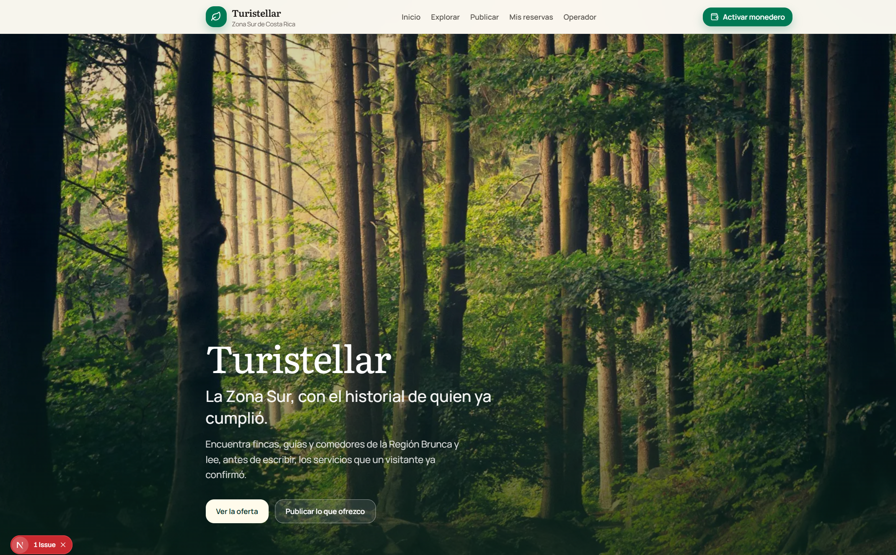
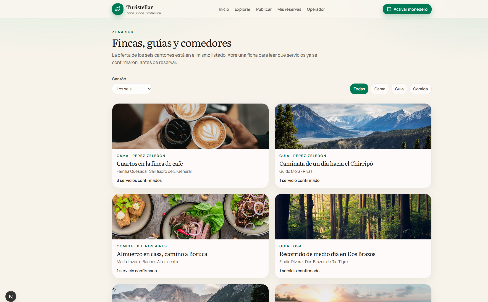
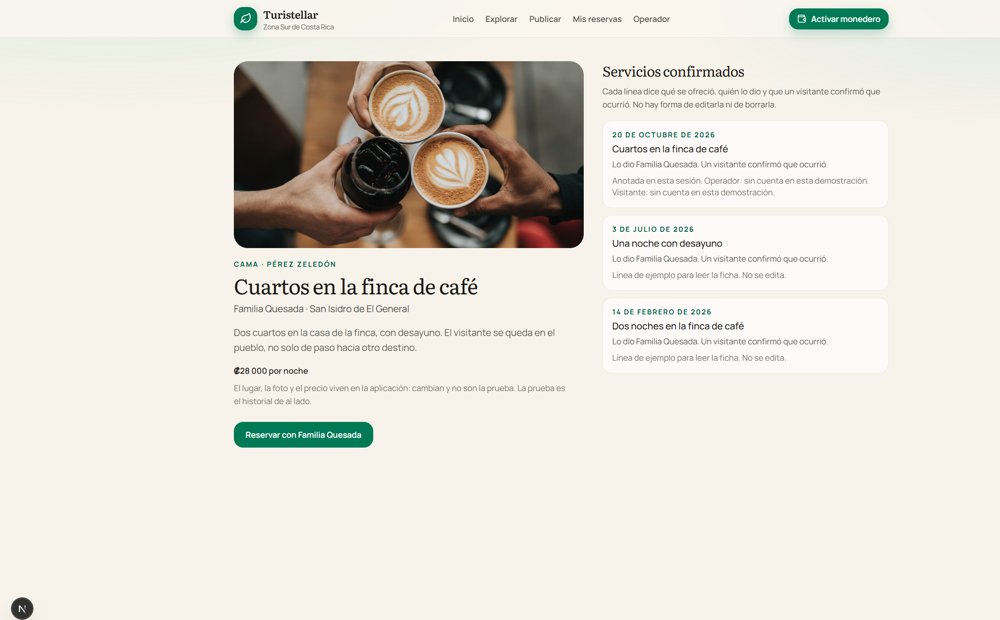

# Documentación — semana 3

Trabajo solo. El producto es Turistellar, el del [Product Blueprint](../semana2/ProductBlueprint.md).

## Front construido

El front de esta semana es el recorrido del MVP. Vive en la aplicación Next.js del repositorio, fuera de `docs/`. El proyecto ya estaba armado en `app/`, y las pantallas nuevas quedaron ahí: no hace falta otra carpeta para ejecutarlas. Quien abre [http://localhost:3000](http://localhost:3000) entra por Inicio y puede recorrer el flujo sin una cuenta de la plataforma. El catálogo de ejemplo cubre los seis cantones de la Región Brunca: Pérez Zeledón, Buenos Aires, Osa, Golfito, Coto Brus y Corredores. Los tipos son los tres que el alcance dejó dentro: cama, guía y comida.

Inicio (`/`) presenta Turistellar y los cuatro momentos del flujo: publicar, leer la ficha, reservar y confirmar. Los botones llevan a Explorar y a Publicar. En esta pantalla no se promete anticipo ni pasaporte de experiencias, porque el Blueprint los dejó fuera. Lo que se ofrece es encontrar la oferta de la zona y leer un historial que después no se reescribe.

Explorar (`/explorar`) es el listado conjunto. Cada tarjeta muestra el tipo, el cantón, quién ofrece, el lugar y cuántos servicios confirmados tiene esa ficha. Se puede filtrar por cantón y por tipo. El orden pone primero las fichas que ya tienen historial, porque la hipótesis se prueba cuando el visitante lee esa prueba y no solo un anuncio. Desde la tarjeta se abre la ficha.

La ficha (`/oferta/[id]`) separa las dos capas de la arquitectura inicial. De un lado están el título, la foto, el lugar, la descripción y el precio. Eso es el catálogo: puede cambiar, y cambiarlo no falsifica un servicio ya dado. Del otro lado está el historial. Cada línea dice la fecha, qué se ofreció, quién lo dio y que un visitante confirmó que ocurrió. No hay botón para editarla ni para borrarla. Una ficha nueva, como el paseo de La Cuesta en Corredores, avisa que el historial aparece cuando las dos partes confirmen. Las líneas que vienen con el ejemplo están marcadas como ejemplo, para poder leer el flujo antes de que exista el contrato. Las que se confirman en esta sesión quedan marcadas como anotadas aquí, y muestran la cuenta si se usó Freighter en Testnet.

Reservar (`/oferta/[id]/reservar`) pide el nombre y la fecha. La reserva queda asociada a esa ficha y a nombre de quien ofrece el servicio. El texto de la pantalla dice que reservar no toca la red. Al guardar, el visitante pasa a Mis reservas.

Operador (`/operador`) es el paso en el que quien prestó el servicio lo marca. Ahí aparecen las reservas que siguen en estado reservada. El botón principal asocia la cuenta de Freighter y solo acepta Testnet. Si la extensión no está, «Seguir sin billetera» deja ver el resto del recorrido, y la línea lo dice. Después de la marca, falta la confirmación del visitante.

Mis reservas (`/mis-reservas`) es el otro lado de la misma firma. Si el operador ya marcó, el visitante confirma y la línea se suma a la ficha. Si la reserva sigue sin esa marca, la pantalla lo dice y no deja confirmarla: el historial no lo escribe una sola parte. Desde ahí se vuelve a abrir la ficha. No hay control para corregir la línea.

Publicar (`/publicar`) es la carga del operador: tipo, qué ofrece, nombre, lugar, cantón, descripción y precio de referencia. Al publicar, la oferta entra al listado y se abre su ficha, todavía sin historial. Publicar tampoco llama a la red.

Lo que se publica, se reserva y se confirma en esta sesión se guarda en el navegador. Sirve para recorrer el MVP de punta a punta en una sola máquina. No es todavía el registro común de la red. Ese registro es el contrato de la decisión de abajo, y esta semana no se invoca, como pide el entregable. La barra deja a la mano Inicio, Explorar, Publicar, Mis reservas y Operador, además del botón de Freighter.

Con esas pantallas quedan cubiertos los siete pasos del flujo del Blueprint. El operador publica. El turista recorre la Zona Sur y abre una ficha. Lee qué se ofreció, quién lo dio y si un visitante lo confirmó. Reserva con esa familia. El operador marca que lo prestó y, si tiene Freighter en Testnet, asocia su cuenta. El turista confirma y asocia la suya. Quien abre después la misma ficha ve la línea nueva.

El front no está hospedado. Se ve al correr el proyecto en local, con los pasos del README. Estas capturas son de ese recorrido.

## Decisión técnica

Opción A. Voy a crear un contrato propio en Soroban, en Testnet. Esta semana no se escribe ni se despliega. La decisión sale del uso de Stellar que el Blueprint fijó en la sección 8, y del criterio de pertinencia del Problem Brief.

El contrato tiene que anotar, para cada servicio, qué se ofreció, quién lo dio y que el visitante confirmó que ocurrió. Esas dos cuentas son las que firman. La ficha lee ese estado por RPC. El contrato no incluye una función para corregir la línea ni para borrarla. Los eventos dejan constancia de cada confirmación, para poder reconstruir el historial desde la red. Eso es lo que el criterio pide: un registro que las dos partes consultan y que ninguna maneja sola. Si la línea se pudiera editar, volvería a ser la reseña que hoy guarda el hotel o la plataforma.

Descarté la opción B. No hay una herramienta del ecosistema que guarde ese historial bilateral, se lo deje a quien caminó o cocinó, y quite de en medio al administrador que hoy puede reescribirlo. Las cuentas, el RPC y los eventos sí se usan, y son piezas de Stellar, pero no reemplazan la lógica de esta confirmación. Un ancla o un activo sirven para mover valor. El MVP dejó el pago fuera. El contrato de depósito que ya está en `contracts/escrow` tampoco cubre esta decisión: retiene un anticipo y lo libera, y el Blueprint sacó el anticipo porque en la Zona Sur muchas reservas ni empiezan. Usarlo como si fuera el historial mezclaría el problema elegido con el que se descartó.

Tampoco alcanza dejar las confirmaciones solo en la aplicación. Esta semana el front lo hace así para que el recorrido se pueda ver. Quien administra esa base puede corregir una ficha, y el visitante tendría que confiar en ese dueño. Por eso el siguiente paso es el contrato propio, no un directorio.

Cuando se escriba, el contrato registra la confirmación y la deja legible para cualquiera. La aplicación sigue guardando lugar, precio y foto, porque eso cambia y no es la prueba. La red entra al firmar y al leer, como dice la arquitectura del Blueprint. Cada persona firma con su billetera. En esta aplicación esa billetera es Freighter, y la red es Testnet.

## Participación del equipo

| Integrante | GitHub | Aporte en este entregable |
| --- | --- | --- |
| Isaac2399 | [Isaac2399](https://github.com/Isaac2399) | Todo el entregable: las pantallas del flujo, la decisión del contrato propio y esta documentación. No hay más personas en el equipo. |

## Bloqueos y siguiente paso

El contrato no está escrito. Es pendiente de esta semana, no un olvido: el entregable pide dejar la decisión y armar el front. El próximo paso es escribir ese contrato en Testnet, sin función para editar o borrar la confirmación, y conectar la ficha y los dos botones de firma a la invocación. Hasta entonces, la línea nueva se ve en el navegador donde se confirmó, no en otra máquina.

Siguen en el repositorio rutas de un prototipo anterior, como el checkout y el tablero del comerciante. No forman parte de este MVP y no están en la navegación de esta entrega.

El front no está hospedado, así que no hay enlace para el campo Website de Apex. Falta cargar el repositorio en Apex. Freighter es opcional para mirar las pantallas; sin la extensión, el recorrido se completa con «Seguir sin billetera».
